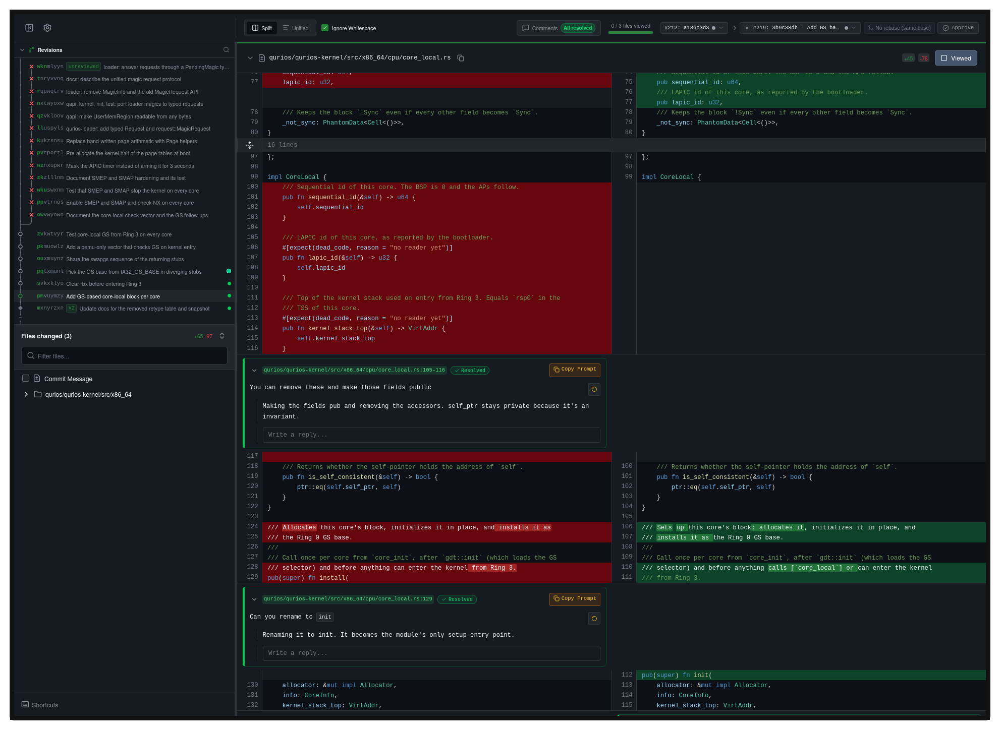

# tellit

`tellit` is a local code review diff viewer and commenting CLI for Jujutsu
(`jj`) repositories. It pairs a browser diff viewer (adapted from
[difit](https://github.com/yoshiko-pg/difit)) with a `tellit comment` CLI that
reads and writes the same local `.tellit/` directory, so humans and coding
agents can review diffs, reply to threads, resolve feedback, and approve commits
without leaving the repository or pushing to a remote forge.

`tellit` stores review state under `.tellit/<change-id>/<commit-id>/`. Grouping
by Jujutsu change ID keeps threads attached to a change across `jj commit`, `jj
squash`, and `jj rebase`. Keying each directory to a commit hash ties direct
approval to an exact tree and commit description, so rewriting a change resets
approval without deleting earlier review history. When run inside a secondary
`jj` workspace, `tellit` follows `.jj/repo` back to the main repository root so
parallel workspaces share one `.tellit/` store.



## Installation

With Nix flakes enabled, run `tellit` directly or install it into your profile:

```bash
nix run . -- launch
nix profile install .
```

The flake also exports `homeModules.default` for Home Manager, which adds
`tellit` to `home.packages` and registers the bundled agent skill at
`skills.tellit` when that option exists.

To build from source instead, provide a Rust toolchain, Node.js 21 or newer, and
`jj` on `PATH` (or enter `nix develop`):

```bash
npm --prefix frontend install --legacy-peer-deps
npm --prefix frontend run build
cargo build --release
```

When run inside the repository checkout, `./target/release/tellit` finds
`frontend/dist/cli/index.js` relative to the working directory. If you move the
`tellit` binary elsewhere, set `TELLIT_WEB_DIR` to the built `frontend`
directory (or `TELLIT_WEB_CLI` to `dist/cli/index.js`).

## Tellit Skill

There's a `skills/tellit/SKILL.md` for your favorite agent. `flake.nix` includes
a `home-manager` module with a `skills` custom configuration. You may use it to
integrate the skill declaratively on your system.

## Reviewing diffs in the browser

`tellit launch` starts the local review server and opens the diff viewer in your
browser:

```bash
tellit launch                  # Review @ (or the latest non-empty ancestor if @ is empty)
tellit launch kkmpptxz         # Review a Jujutsu change ID, commit hash, bookmark, or revset
```

| Flag            | Purpose                                                                             |
| :-------------- | :---------------------------------------------------------------------------------- |
| `--port <port>` | Preferred port to listen on (falls back to an open port if occupied)                |
| `--host <host>` | Host address to bind                                                                |
| `--no-open`     | Start the server without opening a browser                                          |
| `--keep-alive`  | Keep the server running after all browser tabs disconnect                           |
| `--background`  | Detach the server in the background and print `{ port, url, pid }` JSON to `stdout` |

### How Jujutsu review works in the UI

In a Jujutsu repository, the web viewer tracks changes across rewrites rather
than treating each commit hash in isolation:

- **Change graph navigation.** Both the collapsible left-sidebar revision tree
  and the top-bar `Change` menu render the `jj log` graph and let you switch
  changes or look up a change ID or revset.
- **Inter-commit diffs and rebase isolation.** Within a change, the `From -> To`
  controls compare any commit against `parent` or against an earlier revision
  from `jj evolog`. When two revisions of a change have different parents after
  `jj rebase`, `tellit` rebases the earlier revision onto the new parent in
  memory with `git merge-tree` before diffing, so the inter-diff shows only
  edits to the change itself. A toolbar toggle switches back to the raw
  inter-diff when you want to inspect rebase changes directly.
- **Inline threads and approvals.** Click a line number (or drag across a range)
  to start a comment thread, reply to existing threads, or mark them resolved.
  The `Approve` button in the toolbar records or revokes approval on the commit
  currently displayed. When you rebase an approved commit cleanly without
  changing its tree or description, `tellit` carries forward a clean-rebase
  approval indicator on the new commit.

Colored dots in the revision tree and commit pickers show each revision's review
state:

| Dot     | Meaning                                                                |
| :------ | :--------------------------------------------------------------------- |
| Yellow  | Unresolved comment threads exist (takes precedence over approval)      |
| Green   | Commit is directly approved and has no unresolved comments             |
| Emerald | Clean rebase of an earlier approved commit with no unresolved comments |
| Gray    | All comment threads are resolved, and the commit is not approved       |

## Usage Tip

If you want your `tellit` comments to be backed up, I recommend setting up the
`.tellit` directory as a `jj workspace` that points to a shim `tellit-reviews`
branch. This branch will coexist in your repo with the sole purpose of tracking
comments for your past changes. Alternatively, you should consider adding
`.tellit/` to your `.gitignore`

## Managing reviews from the CLI

`tellit comment` reads and writes the same `.tellit/` store as the web UI, so
scripts and coding agents can inspect feedback, reply to threads, resolve
comments, and approve commits directly. Structured output (thread IDs and JSON)
goes to `stdout`, and status messages go to `stderr`. Pass `-s, --store <path>`
to override `<main-repo>/.tellit`, or `-C, --change <rev>` after `tellit
comment` to set the default target revision. Commands that accept a thread ID,
change ID, or commit hash also accept unambiguous prefixes.

### Adding, replying to, and resolving threads

`tellit comment add` creates a new thread on a file or line range (defaults to
`@` unless overridden with `-r/--rev` or `-C/--change`) and prints the generated
UUID v4 thread ID to `stdout`:

```bash
# Line-range comment on @
tellit comment add --file src/lib.rs --at 10..25 --content "Check bounds before slicing"

# Whole-file comment on @-
tellit comment add -r @- --file Cargo.toml --content "Bump crate version?"
```

`--at` (`-a`) accepts a single line (`42`) or an inclusive range (`10..20`,
`10..=20`, `10-20`, `10:20`, or `10,20`).

Use `reply` and `resolve` with the full thread UUID or a unique prefix:

```bash
tellit comment reply a1b2c3d4 "Added an explicit length check."
tellit comment resolve a1b2c3d4
tellit comment resolve a1b2c3d4 --unresolve
```

### Approving commits

`tellit comment approve` records approval for `@` or for a target revision,
change ID, or commit hash (when given a change ID, it approves that change's
latest commit):

```bash
tellit comment approve @-
tellit comment approve @- --disapprove
```

### Querying threads and approvals

`tellit comment get-all` (or `tellit comment get all`) prints matching thread
IDs as a JSON array for a change ID, commit hash, or Jujutsu revision (defaults
to `@`):

```bash
tellit comment get-all --unresolved
tellit comment get-all @- --resolved
tellit comment get-all kkmpptxz
```

`tellit comment get` inspects full thread, change, or commit records:

```bash
# Full JSON for one thread (filepath, line_range, comments, resolved, change_id, commit_id)
tellit comment get thread a1b2c3d4

# All threads, approval boolean, and approved commit IDs for a change as JSON
tellit comment get change kkmpptxz --threads --json

# Commit hashes that have threads under a change (pass --json for structured output)
tellit comment get change kkmpptxz

# Thread objects and approval status for a single commit hash as JSON
tellit comment get commit e9a03f48 --threads --json
```

## Storage layout

By default, `tellit` stores review files under `<main-repo>/.tellit` (listed in
`.gitignore`):

```text
.tellit/
  <jj-change-id>/
    <commit-id>/
      <thread-id>.json
      approval.json
```

Each `<thread-id>.json` file holds a single thread (`line_range` is omitted for
whole-file comments):

```json
{
  "filepath": "src/lib.rs",
  "line_range": {
    "start": 10,
    "end": 25
  },
  "comments": [
    "Check bounds before slicing",
    "Added an explicit length check."
  ],
  "resolved": true
}
```

Each `approval.json` file records direct approval for that commit hash:

```json
{
  "approved": true,
  "timestamp": "1763311523",
  "commit_id": "e9a03f48a127bc9102919d7bca89104812345678",
  "change_id": "kkmpptxz..."
}
```

A change counts as directly approved only when its current head commit has an
active `approval.json`. Running `tellit comment approve <target> --disapprove`
removes matching `approval.json` files for that commit.

## License

MIT. See [LICENSE](LICENSE). The web diff viewer in [`frontend/`](frontend/) is
adapted from [difit](https://github.com/yoshiko-pg/difit), also under the MIT
License.
